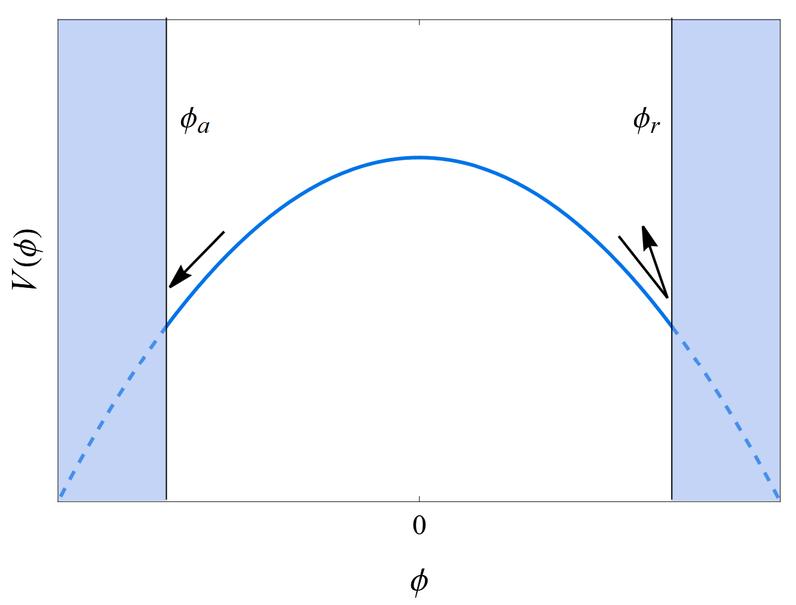
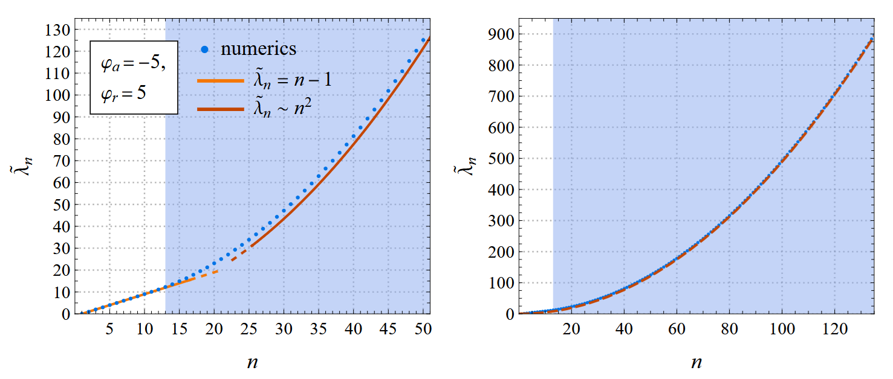
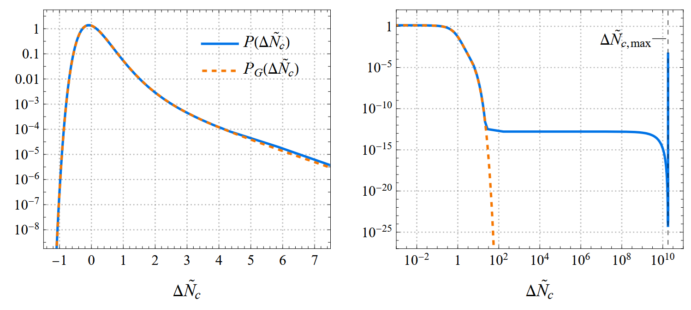

[**Eemeli**](/members/eemeli.html) exploits spectral methods to solve
a stochastic inflation model in which the field goes over a hilltop
potential and tunnel back to an exit boundary. For such a
configuration, the mean value of the lifetime fails to properly
describe the inflationary background and alternatives are proposed.

Early in the cosmic history, during [**cosmic
inflation**](https://en.wikipedia.org/wiki/Cosmic_inflation), space
expands rapidly. This expansion produces primordial perturbations that
are important for the Universe's later evolution: they may, for
example, collapse into [**primordial black
holes**](https://en.wikipedia.org/wiki/Primordial_black_hole). These
perturbations can be studied with stochastic inflation, a non-perturbative technique
that traces the random motion of a coarse-grained inflaton $$\phi$$, the scalar field
that drives inflation.

Stochastic inflation lets us compute the probability distribution
$$P(\phi, N)$$ of $$\phi$$ at a given moment $$N$$ (a time variable that
grows in sync with the spatial expansion). The distribution follows
the [**Fokker-Planck equation**](https://en.wikipedia.org/wiki/Fokker%E2%80%93Planck_equation)

$$\partial_N P(\phi,N) = \underbrace{\partial_\phi\left[\partial_\phi\left(\frac{1}{2} \sigma^2(\phi) P(\phi,N)\right) - \mu(\phi) P(\phi,N)\right]}_{\equiv \mathcal{L} P(\phi,N)},$$

where $$\sigma$$ and $$\mu$$ are the diffusion and drift functions of the
associated stochastic process. Equations of this form can be solved with the
so-called spectral method, by computing the eigenfunctions $$u_n(\phi)$$
and eigenvalues $$\lambda_n$$ of the Fokker-Planck operator $$\mathcal{L}$$:

$$\mathcal{L}u_n(\phi) = -\lambda_n u_n(\phi).$$

The new paper  exploits the spectral method for stochastic
inflation, solving for the following explicit equation for $$P(\phi,N)$$,
starting from an initial value $$\phi_0$$:

$$P(\phi, N) = \sum_{n=1}^{\infty} \bar{u}_n(\phi_0)u_n(\phi)e^{-\lambda_n N},$$

where $$\bar u_n(\phi)$$ is the adjoint eigenfunction, which can be
related back to $$u_n(\phi)$$. One may also derive a similar expression
for the total duration of inflation $$N$$. The duration is important for
the so-called $$\Delta N$$-formalism, which gives the local curvature
perturbations as a difference between $$N$$ and an averaged background
value:

$$\zeta = \Delta N = N - N_\mathrm{bg}.$$

After developing the spectral formalism, Ref.  applies it to the special case of hilltop inflation, where the
inflaton potential $$V(\phi)$$ resembles an inverted parabola, as
sketeched in the figure below. Such models are important in the study
of primordial black holes (see, e.g., [**this post**](). They correspond to **constant-roll
inflation**, where the drift $$\mu$$ grows linearly with the distance
from the hilltop.

In these models, $$\phi$$ typically undergoes stochastic motion on the
left-hand slope of the parabola, close to the end of inflation limit
set by an exit boundary $$\phi_a$$. Eemeli earlier solved the system
in this limit in [arXiv:2304.10903](https://arxiv.org/abs/2304.10903). However, this
solution did not cover the rare, large perturbations that take
$$\phi$$ to the other side of the hilltop. Ref.  now takes them into account. We place a reflecting boundary on that
side at $$\phi_r$$ to mimic a local potential minimum typially found in
primordial black holes models. If the field crosses the hilltop, it
may spend a long time stuck near $$\phi_r$$ before tunneling back out.

The spectral decomposition is well-suited for studying the long-time
behaviour, since most terms in the eigensums above become small in
this limit, leaving only a few leading contributions. The eigenvalues
$$\lambda_n$$ can be solved semi-analytically, and they follow
characteristic scalings for small and large $$n$$, as can be seen in the
figure below.

As this figure shows, the first eigenvalue is very small, $$\lambda_1
\ll 1$$; it is responsible for the tunneling behaviour described
above.

Armed with the eigensolutions, we can solve the probability
dsitribution of $$\Delta N$$. There is a subtlety, however: to compute
$$\Delta N$$, we need to choose the background value
$$N_\mathrm{bg}$$. Conventionally, this is chosen to be the **mean**
of $$N$$. In our setup, however, the mean is enormous, dominated by
the tunneling solution of the lowest eigenvalue. The rare stochastic
trajectories that get stuck near $$\phi_r$$ for a long time completely
drown out the typical trajectories that never cross the hilltop. Thus,
the mean does not describe the typical field behaviour well, and is
ill-suited as a background. Such a problem also occurs in
semi-infinite flat potentials, see [**this post**]().

Instead of the mean, one may consider the
[**median**](https://en.wikipedia.org/wiki/Median) of $$N$$ as
$$N_\mathrm{bg}$$. This works better: it turns out that near $$\phi_a$$,
the median follows the classical, non-stochastic expectation, around
which most trajectories cluster. Using the median, we can finally
estimate the $$\Delta N$$ probability distribution, given by the figure below.

In this figure, the dashed line corresponds to the old, one-sided
prediction of [arXiv:2304.10903](https://arxiv.org/abs/2304.10903). For large $$\Delta N$$
values, trajectories that cross to the other side start to dominate
and the old prediction fails; it is replaced by a long plateau and
then a peak at the typical tunneling-out time. One should expect
similar behaviour in realistic primordial black holes models.
